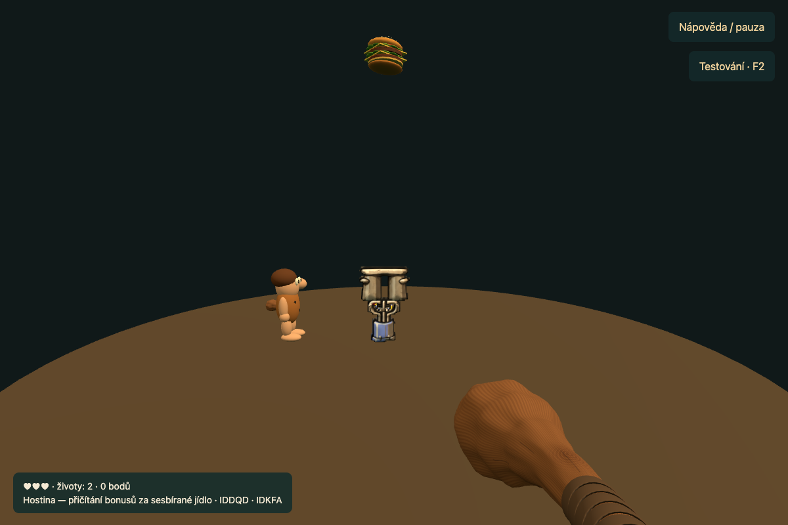
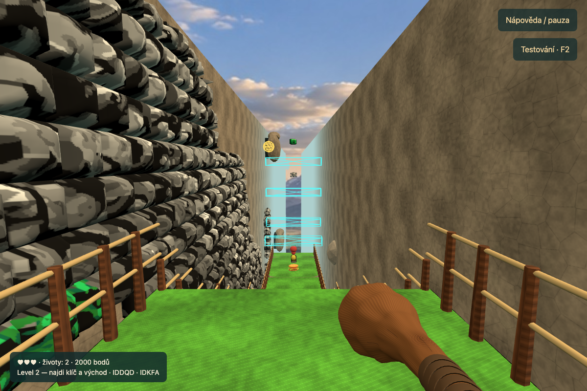

# Native feast transition and second VR level

The default `/vr/` adventure now continues from the complete first level into the second. This is a two-level VR slice; level 3 and bonus world D are explicit future destinations, not silently substituted maps. The 2D game and its Kubernetes routing are unchanged.

## Behavior and controls

The first keyed exit closes the view, shows Prehistorik running toward the original three-part bowl/apparatus, counts the collected food into score, and closes/reopens the view at the second level's original start. The actor runs; the tracked camera never follows an automatic run. Original BRAVO music accompanies the feast, then MINES resumes in level 2. Scores, spare lives, weapon and IDDQD/IDKFA persist. Native level setup resets health, level-specific inventory/key and checkpoints. After entering level 2, release sticks, A and B once before moving again.

A remains jump; the physical club, smooth turning, magic controller combinations and passages retain their controls. **B also drops through class-5 ledges when away from a passage**; use G for this on desktop. This is required for the second level's descending route. B takes priority as a passage action near a cave mouth. Neighboring entrances are selected by distance, including the adjacent key-room return records. R restarts the current level; after game over or the end of the current slice, B also restarts it.

The ordinary second-stage route descends the mountain, uses passage 15, rides platform 8 up from the lower cave, takes passage 17 to the isolated key chamber and passage 16 back, and finishes through the unlocked exit. A separate lower exit leads to bonus world D in the original. Both destinations remain identified in the simulation; the browser shows an explicit end-of-slice message instead of loading an unfinished world. Entry into bonus D does **not** cash the food ledger prematurely.

## Recovered rules versus VR interpretation

Observed original behavior is retained from the Ghidra/REA audit in the sibling, intentionally unversioned `analysis/STAGE-TALLY-AUDIT.md`, `analysis/evidence/stage-tally-20261020-rea.json` and `analysis/pseudocode/raw/game/0x14e5d.c`. No original executable or emulator was run for this change. The verified decoded image SHA256 is `094404bc9a9fa649e3b4b12015bc2a74f7c69ad78e82a9f8baf30a802923a10b` (DOS MZ, x86 real mode, segment 1000, Ghidra 12.1.4).

- Completion dispatcher `0x14e5d`: REA `ev_ad1a39c1b60f06f6df956215b838dcaa0cd7df10b0cf2751d7cf434f7567b644`. The neutral recovered tally implementation is preserved in [stage-tally.js](../../dist/vr/js/stage-tally.js), integrated by [campaign.js](../../dist/vr/js/campaign.js).
- Iris `0x13350`: REA `ev_dbbbf436928bd600123e8a400dc35ce95a015db29aa87446ae738968ab395330`. The native 48-retrace close still determines sequencing. The visible full-view VR fade is an authored comfort adaptation, not a claim that DOS used an identical fade.
- Scoring `0x15391`: REA `ev_6e0571bbb910397ef21e07839239e2462a0621708037b95008adf58d18fd7572`. The 113 byte food counters map sprites 110–222 through DS:a371 and AWARDS. Items spawn every eighth 70Hz retrace, accelerate by 8 to 128, and score on reaching Y145. Each collected food scores its individual value a second time. Empty ledgers skip counting; no flat, health or arbitrary life bonus is added. Only the existing score threshold awards an extra life. The consumed ledger prevents `World.advance()` from awarding it twice.
- Machine animation `0x153de`: REA `ev_06751ace7da590e792192d421f1490119dca8be1dd68ae378556036ae2cf6514`. Parts 100/98/104–109, entry/exit positions and native timing are retained. Actor animation tables DS:7ba3/7c67/7cab drive the presentation state; the new spectator actor is an authored smooth 3D interpretation, with a running gait rather than recovered skeletal animation.

Only the feast uses mixed native PIT/retrace timing. Gameplay remains fixed 90Hz VR movement with recovered actor/secret/platform updates at 24.275Hz. The headset pose, gameplay actor frame and RNG remain frozen during the feast. The stage is anchored in front of the viewer at its start, and remains in world space when the viewer looks away. Hands cannot award hits during the transition. Pause/test-menu/hidden-session rules still suspend the presentation.

## Second-stage data and rendering

All source records come from `dist/vr/assets/game.json`, `level-2.map`, `tiles-2.idx`, `footer-2.bin` and the shared union/sprite/table banks:

- Complete 256×104 map, original start (52,144), source conversion X/32 and (672−Y)/32.
- 68 active item/marker records, 9 concealed cells, 9 moving/falling platforms, 7 active passage records.
- 41 enemy definitions: 29 normal plus 12 expert-only definitions. Normal mode uses the original filter, not invented additional spawns.
- Both the locked normal exit (item 19, sprite 278 →279) and the bonus exit (item 31, sprite 311) are retained. The isolated key is item 12 at (1944,120).

The second stage occupies its own continuous source XY space, including packed remote rooms. The first stage's Y<256 cave split and −5.5m pit threshold do not apply to it. Falling below the entire second map still triggers checkpoint rescue, including with IDDQD. Floor-class 6 becomes supporting terrain in god mode as in the native collision code. The second-stage horizontal wall probe uses the original lowest 16px body band; ceiling hits remain separate. Depth movement clamps to the strip without sideways wall ejection, preventing stationary players from being pushed out of passage reach. Narrow source corridors remain subject to tracked-head occlusion rather than revealing through opaque walls.

The padded 4x [level-two atlas](../../dist/vr/textures/tiles-hd-2.json) is rebuilt reproducibly with `node scripts/build-vr-level-two-art.mjs`. It uses the second stage's own tile lookup and palette, including grey rock. It does not reuse level-one brown tile indices, and is explicitly connected-contour scaling, not a new AI image claim. Existing HD food, creatures and jointed upright bears share their geometry/sprite cache between stages. Only terrain is level-specific. Both atlases and recipes are prepared before play; old scene resources are detached/disposed at the opaque switch. Forest, opaque depth walls and mountain panorama visibility follow the second stage's height. Back-wall depth and underground height threshold are authored 360° scenery, not native hidden geometry.

## Validation and outstanding acceptance

- `node --test tests/*.test.mjs`: tally phases/cadence, no premature skip or double award, exact score/life carry, frozen pose/RNG, input rearming, all seven passage destinations, ledge dropping, map/record coverage and exact 4x tile pixels/hashes.
- `tests/fixtures/vr-level-two.json`: 6,270 fixed steps using joystick X, A and B only, IDDQD enabled. Completes the native normal exit, actually rides the lift, collects the key and returns through passages 15/17/16, with no teleports, world edits or pit rescues.
- `scripts/verify-vr-campaign-browser.mjs`: rendered darkening, approach, falling-food feast, exact bonus and level switch; grey-rock terrain, lower cave and isolated key room; stereo level-two rendering and controller movement. Evidence is a CI artifact in `quest-vr-xr-test/campaign/`.
- Existing full first-level, secret/HD, combat, tracked-club, haptic, pause and XR regression suites remain required by the publication workflow. Multiarchitecture image smoke tests also request the new modules, second-stage assets and BRAVO music.
- Physical Quest performance, visibility/comfort in low corridors and the spectator presentation require device acceptance. Automated WebXR is a simulated headset, not a hardware measurement. Neither level 3 nor bonus D is playable in this slice. No original binary files, decompilations or analysis reports are included in this Git repository.

## Resume checklist

- [x] Native-scored feast and automatic level 1 →2 transition.
- [x] Entire second map, normal enemy records, items, gates, platforms and HD terrain.
- [x] Input-only stage-two completion fixture and desktop/mock-XR presentation checks.
- [x] Original file hashes checked against all 54 retained manifest entries; unchanged.
- [ ] Physical Quest acceptance, especially low passages and transition comfort.
- [ ] Extend beyond this slice to stage 3 and bonus D with their own source audits and traversal tests.

