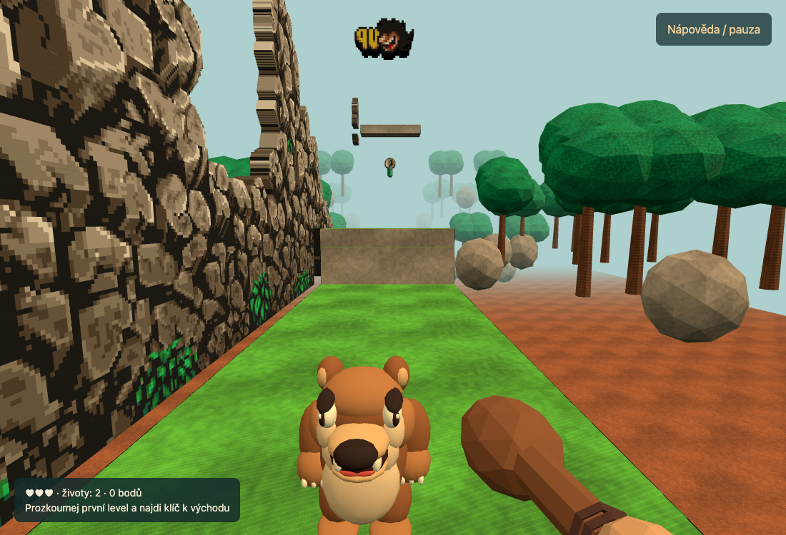

# Quest 360° — playable first level

The `vr/quest-360` branch runs the first level at **`/vr/`** as a stereoscopic 3D world with tracked hands, physical club combat and free movement in depth. It now loads the complete original map, instead of the old 32m practice course.

The upright bear follows the original walking and ground-emergence families. The full level includes the mountain, late chasms, bonus rooms, 65 authored item/marker records, 48 secret cells, all eight passage records, 13 normal enemy definitions, three moving/falling platforms, two checkpoints, the key and the locked exit. See [source audit](LEVEL-ONE-SOURCE-AUDIT.md), [bear reference](BEAR-REFERENCE.md) and [implementation/acceptance record](LEVEL-ONE-IMPLEMENTATION.md).

**Status:** automated simulation, desktop WebGL and mocked WebXR checks pass. Physical Quest performance, stereo comfort, grip alignment and haptics still require device acceptance. The bear and terrain are editable procedural 3D interpretations. Other enemies now have anatomical 3D models (spider, dinosaur, bird). Food now uses newly crafted3D recipes, including burgers and fries; remaining pickups/decorations use rounded surfaces reconstructed from the HD silhouettes. These models are authored interpretations of the unseen depth; production sculpted/rigged GLB replacements remain future work.



Latest: [carved wooden club, environment contact and haptic priority](CLUB-CONTACT-HAPTICS.md).

Previous: [side rails, impact feedback, original music, crafted food/dinosaurs and underground bonus](RAILS-IMPACTS-MUSIC-BONUS.md).

Previous: [smooth turning, full-volume objects, occlusion and mountain panorama](SPATIAL-ART-AND-TURNING.md).

Previous: [secret-hit performance fixes, HD art, walking caves and IDDQD/IDKFA controls](HD-PERFORMANCE-CHEATS.md).

## Run and play

No install or build is required; Node 22+ serves the vendored runtime:

```sh
PORT=5777 node scripts/serve.mjs
```

Open <http://127.0.0.1:5777/vr/> on the development machine. On Quest, open the same hosted **HTTPS** `/vr/` address in Meta Quest Browser and enter VR. A LAN HTTP address is insufficient for immersive WebXR.

- **Left stick:** move relative to head direction. Centre it once after entering/resuming VR. Neutral stops immediately.
- **Right stick:** smooth proportional turning, easing up to90°/s around the tracked head.
- **Left X:** music on/off. The original level-one MINES track starts after launch; pause/test menu mutes it.
- **Right A:** jump. Holding it during a bear head bounce gives the higher rebound. Physical jumping is not required.
- **Passages:** walk into the visible mouth with the left stick; movement follows the current look direction. Right B is an alternative. After completion/game over, B restarts.
- **Magic controller combination:** hold both index triggers until a short vibration (about0.7s), keep holding and tap right **A three times** for IDDQD or **B three times** for IDKFA. Release both triggers afterward. Repeat to disable. Gameplay pauses during the combination.
- **Left Y:** alternative paused test menu. Right A toggles IDDQD; right B toggles IDKFA; Y closes it. Release sticks/buttons to resume.
- **Club:** swing the selected controller. The wooden shaft stops against terrain, rails and other solid scenery; contact gives a short vibration. Pull the controller back to release it. A button cannot substitute for a physical strike.
- **Wrist panel:** hearts, spare lives, score, key objective and passage prompt.

Find the key near the far-right exit. Killing a bear is optional. Club blows reveal original hidden terrain and rewards, with original durability/cooldown rules. Only enemies that actually took a heart release recovery bones; six bones return a heart. Falls vibrate, fade and return to the latest checkpoint. After spare lives are exhausted, restart with B.

Desktop: **WASD/arrow keys**, drag to look, **Q/E** snap turn, **Space** jump, **F/click** swing, **G** alternative passage action, **Esc** pause, **R** restart. Type **IDDQD** / **IDKFA**, or use **F2** for the paused test menu. B/keyboard passage also restarts after finishing. The old practice course remains only as `?qa&pilot=1` for controller regression fixtures.

## Automatic GHCR build and Kubernetes deployment

Every push to **`vr/quest-360`** runs [Publish Quest VR image](../../.github/workflows/publish-vr-image.yml). It runs all tests, builds `linux/amd64` + `linux/arm64`, verifies the OCI index and smoke-tests `/healthz`, `/vr/`, the 3D modules and recovered map assets inside the published container.

Images use the existing `ghcr.io/michalmedvecky/pre2-web` package with separate VR tags:

- `vr-sha-<full-commit-SHA>`: a specific build; consult its successful workflow result.
- **`vr-quest`**: rolling alias published only after the tests and container smoke check pass.
- The run summary records the exact `@sha256:...` image. Artifact **`quest-vr-deploy`** contains digest-pinned `kubernetes.yaml`, `image.txt`, `commit.txt` and an optional `ingress.example.yaml` template.

The web workflow, web image tags and namespace `prehistorik` are independent. No Docker build is needed on your computer. GitHub uses its built-in `GITHUB_TOKEN` with `packages: write`; no registry PAT is needed in repository secrets. The package must allow pull access from the cluster.

### One-command rollout or update

Prerequisites: Node 22+, kubectl, a working kubeconfig, an existing ingress controller, and a trusted certificate/TLS secret in namespace **`pre2-vr`**. Point DNS at that ingress. Provision the certificate with your existing cluster mechanism; the script does not create a certificate issuer or request cluster credentials from GitHub.

Run from this worktree (or a checkout of `vr/quest-360`):

```sh
node scripts/deploy-vr.mjs \
  --context YOUR_CLUSTER_CONTEXT \
  --host pre2-vr.your-domain.cz \
  --ingress-class nginx \
  --tls-secret pre2-vr-tls
```

The script resolves the tested public `vr-quest` tag to its OCI digest, verifies both architectures, renders isolated manifests, applies them to the explicit context and waits for rollout. Re-run the same command after the next successful build. Changed digests update the Deployment automatically; it does not rely on restarting pods behind a reused mutable tag. Open **`https://pre2-vr.your-domain.cz/vr/`** on Quest.

For an existing ingress you want to preserve, use `--no-ingress` instead of `--host`. For rollback or an exact release, pass `--image ghcr.io/michalmedvecky/pre2-web@sha256:<digest-from-successful-run>`. For a private package, also pass `--pull-secret YOUR_EXISTING_SECRET` and an explicit image digest; automatic anonymous tag resolution requires a public package. The pull secret must exist in namespace `pre2-vr` before the workload starts.

To inspect the resulting files before applying, append `--render-only /tmp/pre2-vr-rendered`. This performs no cluster writes. Alternatively, download `quest-vr-deploy` from the successful Actions run and apply its pinned `kubernetes.yaml`, then adapt/apply `ingress.example.yaml` once.

Static templates live in [deploy/vr/](../../deploy/vr/): a separate namespace, two replicas, Service, health probes, non-root security context, read-only root filesystem and writable `/tmp`. The runtime keeps its imports and assets under `/vr/`, including `/vr/native/` and `/vr/assets/`. The existing pre2.500miles.cz ingress can route this prefix independently of the 2D image. The template uses `vr-quest`; prefer the script or CI artifact for a digest-pinned rollout.

This automates image publication and renders deployment-ready configuration. Cluster rollout runs where you invoke the script, not inside GitHub. Your own CD can invoke the same command using its kubeconfig. No cluster deployment was performed when preparing this feature.

No GPU is needed on the cluster; the headset renders locally. HTTPS with a browser-trusted certificate is required for WebXR.

## Rules and implementation boundaries

`dist/vr/js/level-one.js` bridges the recovered `World` to a continuous 90Hz VR player. Enemy dispatch/animation, platform byte records, indexed items, score tables, secret counters and gate destinations run from the unchanged shared engine at 24.275Hz. Its original camera is an AI/animation visibility reference; it never controls the tracked head. `dist/vr/native` and `dist/vr/assets` are repository symlinks keeping all browser requests below `/vr/`.

At 32px/metre the map is 128m wide. Source XY placement and constant 1–3px floor offsets are retained. The authored walking strip is 3.6m deep; upper packed bonus maps form a separately visible cave zone. Its Y boundary is native256, retaining outdoor secret71 at row18. Moving actors/platforms/effects keep their origin zone when crossing this packing boundary.

VR tuning: speed2.6m/s, gravity14m/s², fixed jump8m/s (~2.24m maximum rise), collision height1.05m and radius0.23m. Head bounces use2.95m/s (~10px rise) or9.6m/s (~105px rise) while A is held. These are ballistic adaptations of recovered access heights, not the native integer/variable-hold trajectory. Actual head height remains tracked and is separate from the collision body; seated calibration and ceiling comfort need device testing.

Club sampling requires1.35m/s and0.12m relative travel, rearms below0.55m/s and rejects tracking gaps/pose jumps. A sweep tests tip travel plus the current shaft. Gate/checkpoint relocation resets sweep history before contact detection, preventing attacks across a teleport. Passage interaction has a deliberately broader near-feet window than exact native tile matching; fresh B consumption prevents ping-pong.

Native tile faces, animation triplets and palette colours are retained; closed depth, stone/grass/forest backs, cave enclosures, arch mouths and lighting are authored. Native sprite silhouettes become closed HD textured meshes, with cached faces and silhouette side walls. There are no per-pixel front/back polygons to regenerate during a hit. Small source sprites are oriented for readability along the first-person route. Terrain/decor use spatial chunks and batches. No unflagged foreground-table junk is rendered.

The first level has no boss. The exit reports completion; level two is not yet implemented in VR. There is no claim of finished campaign parity, production 3D art, physical Quest validation or original DOS runtime observation. No DOS executable was run.

## Tests and saved progress

```sh
node --test tests/*.test.mjs
PRE2_VR_URL=http://127.0.0.1:5777/vr/ node scripts/verify-vr-level-one-browser.mjs
PRE2_VR_URL=http://127.0.0.1:5777/vr/ node scripts/verify-vr-xr-browser.mjs
```

`node scripts/verify-vr-hd-browser.mjs` also verifies the reported secret stalls, score orientation, walking passages and keyboard/Quest cheat menus.

The browser scripts require Playwright1.62.1/Chromium installed separately, or `PRE2_PLAYWRIGHT_MODULE=/absolute/path/to/playwright/index.mjs`. Both run before the GHCR alias is promoted. Reports and screenshots default to a temporary directory; checked evidence is retained in this folder.

The whole outdoor route test uses ordinary movement/jumps from the true start through the central mountain and late chasms to key/exit, with invulnerability enabled, no gates/teleports and zero falls. Cave, collectible, platform and secret tests use explicit source-object fixtures; those do not prove ordinary-input discovery of every optional treasure. All13 normal enemy definitions are independently activated through their source dispatch. Mock WebXR exercises actual Three stereo/grip paths, not physical headset hardware.

The resumable checklist and known limits are in [LEVEL-ONE-IMPLEMENTATION.md](LEVEL-ONE-IMPLEMENTATION.md). `?qa` exposes test state; normal pages expose read-only snapshots. Original binary hashes are checked read-only outside this Git repository; decompilation/report files are not copied into it.
