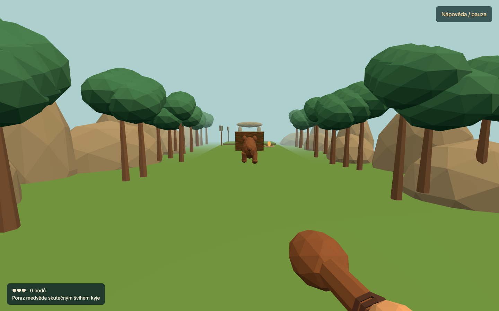

# Quest 360° pilot — first playable slice

This branch (`vr/quest-360`) contains a first-person, stereoscopic WebXR pilot at **`/vr/`**, alongside the unchanged desktop game at `/`. It is a real 3D scene with closed meshes, free movement in depth, tracked hands and head, a physical club, and a walking bear. It is not a canvas displayed on a screen in VR.

**Validation status:** desktop browser playthrough and simulation tests pass. A physical Quest has not yet been tested. Controller tracking, stereo appearance, haptics, comfort, performance and headset/browser compatibility remain hardware acceptance items. The procedural models are editable prototype art, not finished production meshes or recovered 3D originals.



Recorded verification: [validation.json](validation.json), 221 passing tests (209 existing + 12 VR), normal browser course completion, deliberate pit rescue and restart.

## Run locally

From this worktree, with Node 22+ installed:

```sh
PORT=5776 node scripts/serve.mjs
```

Open <http://127.0.0.1:5776/vr/>. Port 5776 avoids the web worktree's usual 5775. No npm install or build is required. Three.js 0.186.1 and its MIT license are vendored with package integrity and file hashes in `dist/vr/vendor/provenance.json`; the runtime makes no CDN requests.

Desktop controls: **WASD** move, drag the mouse to look, **Q/E** turn 30°, **Space** jump, **F** or a click swing, **Esc** pause/resume, **R** restart. A short Space press is buffered until the next physics update. The desktop swing exercises the same motion/geometry attack detector as the tracked club; it is a testing fallback.

## Play on Quest

Serve this branch's `dist/` through trusted **HTTPS**, open `https://YOUR_HOST/vr/` in Meta Quest Browser, choose the club hand and press **Enter VR**. The application requests `immersive-vr` with `local-floor`, and detects support before entry. HTTP localhost works on the development machine; a LAN HTTP URL on the headset is not a substitute for trusted HTTPS.

- Left stick: movement relative to the horizontal head direction, including depth.
- Right stick: 30° snap turns with a neutral rearm threshold, pivoting about the tracked head.
- Right **A**: jump. Physical head movement is tracked for viewing and body placement, but is not interpreted as an automatic jump.
- Club: swing the selected controller. No trigger press causes an instant attack. The club follows the grip pose; no pose means no attack. Loss of tracking, long frame gaps, recentering, turning and disconnection reset motion history.
- Left wrist panel: health, score and objective. Use the headset system menu to leave the session; on return to the desktop preview it is paused.

Objective: defeat the practice bear, cross the native first rock, reach the campfire checkpoint, jump the practice gap, then walk through the stone finish marker. A fallen player receives a short vibration request and synthetic falling sound, fades to black, returns to the checkpoint during the opaque portion, and fades back in. The game does not tilt, shake or animate the tracked head. A pit fall loses one heart; zero health resets to three at the checkpoint. Bear defeat and score persist through a fall. Restart clears the slice.

Button jumping is the default for a predictable action in both seated and standing play. It produces a game-space jump of the locomotion rig; comfort must be tested on the device. Optional physical jumping is deferred, rather than guessing intent from ordinary head motion.

## Host separately from the web release

The existing Dockerfile also serves `/vr/`. **The main branch's pinned GHCR web image does not contain this unmerged prototype.** Build this worktree and deploy a separate image/application; do not replace the web deployment while testing VR.

```sh
# Set this to a registry/repository you can push to.
VR_IMAGE=registry.example.com/games/pre2-vr:quest-pilot
# Pick the architecture of the cluster nodes; arm64 is also supported by the base image.
docker build --platform linux/amd64 -t "$VR_IMAGE" .
docker push "$VR_IMAGE"

kubectl create namespace pre2-vr --dry-run=client -o yaml | kubectl apply -f -
kubectl -n pre2-vr create deployment pre2-vr --image="$VR_IMAGE" --port=8080 --dry-run=client -o yaml | kubectl apply -f -
kubectl -n pre2-vr expose deployment pre2-vr --port=80 --target-port=8080 --dry-run=client -o yaml | kubectl apply -f -
```

Route your HTTPS ingress to service `pre2-vr`, port `80`, in namespace `pre2-vr`. For an nginx ingress, replace the hostname and provision the TLS secret using your cluster's certificate mechanism, then apply:

```yaml
apiVersion: networking.k8s.io/v1
kind: Ingress
metadata:
  name: pre2-vr
  namespace: pre2-vr
spec:
  ingressClassName: nginx
  tls:
    - hosts: [vr.example.com]
      secretName: pre2-vr-tls
  rules:
    - host: vr.example.com
      http:
        paths:
          - path: /
            pathType: Prefix
            backend:
              service:
                name: pre2-vr
                port:
                  number: 80
```

No GPU is needed on the cluster; the headset renders locally. The root path serves the desktop build and `/vr/` the pilot. Use a dedicated hostname with `/` forwarding, preserving the relative `../assets/` paths. The deployment is not automated or published by this prototype task.

## Evidence and interpretation

The first 64 columns, native rows 28–48, of `dist/assets/level-1.map` are read at runtime. Native coordinates use 32px/metre, X → X and downward Y → negative Y, with the starting floor at native Y=672. Only floor callback classes 1–5 become half-metre box colliders. Concealed secret substitutions are applied to a copy before construction. The original asset bytes are never changed. Sloped tile contours, secrets and upper routes are not yet implemented as full 3D gameplay.

Native references retained from `dist/js/engine.js` and the recovered level data:

- club damage **25**; representative level-one type-9 bear HP **15**; the native strict negative-HP defeat comparison is retained;
- scoring uses the shared `AWARDS` table and the source bear's score class, displayed as **500** points;
- harmful contact marks an enemy; only a marked defeated bear releases six collectible bones, and collecting all six returns one heart (maximum three). Untouched defeated bears release none. This follows the native contact flag (`0x185c4`) / defeat test (`0x18ee5`) documented in the web reconstruction;
- descending contact with a bear's head bounces the player, with a larger bounce while holding jump. The 3D impulses are pilot tuning, not recovered native trajectories.

New authored choices: a 6.4m-deep route with elevated rocks narrowed to 2.2m depth, bounding scenery, a practice bear relocated to X=12m (the source bear record is farther into the native level and on another elevation), a 25–27m practice gap, campfire/checkpoint at 22m and finish at 31m. The route is not a claim that the original opening contained this bear or pit. Floor shapes are boxed approximations; upper decorative collision surfaces remain from the source map. Trees, rock rear faces, hands, club and bear depth are new procedural interpretations of the original palette/silhouettes, not reconstructed unseen surfaces.

The isolated `Pilot` simulation runs at 90 fixed updates/second; the original DOS-derived `World` and its tick rate remain unchanged. New 3D tuning is explicit in `RULES`: 2.6m/s walk, 14m/s² gravity, 6.9m/s jump impulse, .23m body radius, 1.45m collision height. The tracked head determines horizontal body placement; rescue compensates physical offsets so room-scale movement does not strand the player outside the floor. Head/body collision height is currently fixed; configurable seated calibration and crouching are pending.

Club samples measure motion in rig space to exclude stick locomotion and teleport displacement. A swing needs 1.35m/s and .12m travel, rearms below .55m/s, rejects frame gaps above .1s and pose jumps above 18m/s. Contact tests sweep the tip between frames and check the current shaft against two bear body volumes. A consumed swing cannot hit again until rearmed. These are intentionally new reach and motion rules for 3D.

## Source layout

- `dist/vr/js/simulation.js`: pure, testable 3D traversal, collision, swing recognition, combat, checkpoint and finish rules.
- `dist/vr/js/models.js`: editable procedural mesh/animation construction and instanced scenery; textured soil derives colors from a native tile, with softened contrast. No core actor/environment billboards.
- `dist/vr/js/main.js`: Three.js/WebXR presentation, grip sampling, controls, wrist UI, synthesized spatial hit sound, best-effort vibration and fade.
- `tests/vr.test.mjs`: meaningful unit/integration coverage, including normal course completion and room-scale rescue.
- `scripts/verify-vr-browser.mjs`: browser playthrough using keys and the real animated club, fall/return/completion, pause/restart and 360° rear-view capture. It saves evidence outside the repository by default.

```sh
node --test tests/*.test.mjs
# Install Playwright separately or point to an existing ESM installation.
PRE2_PLAYWRIGHT_MODULE=/absolute/path/to/playwright/index.mjs \
  node scripts/verify-vr-browser.mjs
```

`?qa` exposes the isolated pilot/layout/renderer for testing; normal pages expose read-only snapshots only. WebXR requires actual hardware acceptance, not merely passing this desktop script. Browser verification uses software WebGL and makes no headset frame-rate claim. Static scenery and terrain use instancing, no realtime shadows or external model downloads.

## Next acceptance work

- [x] 360° mesh world, depth movement, closed bear/club geometry and animated bear.
- [x] Physical motion-based club, handedness, button jump, contact damage, native conditional bones/heart recovery.
- [x] Checkpoint/fall fade, room-scale offset compensation, short route completion and desktop regression checks.
- [ ] Test Quest model(s): stereo, grip orientation, left/right controls, timing of haptics, controller reconnect, tracking loss, boundary/recenter and interrupted sessions.
- [ ] Measure real CPU/GPU frame time, dropped frames, memory and thermals. Confirm an actual headset refresh rate before setting a budget.
- [ ] Calibrate seated/standing height and locomotion comfort; add an in-world pause/restart menu.
- [ ] Replace procedural art with authored UV/rig/LOD/GLB assets and original-style animation clips; the first-person hero currently has hand meshes, with a simple body only in the desktop preview.
- [ ] Implement source slopes, native secret steps and full opening asset placement, then expand the route and remaining enemies.

API references used: [Three.js VR setup](https://threejs.org/manual/pages/how-to-create-vr-content.html), [WebXRManager](https://threejs.org/docs/pages/WebXRManager.html), [WebXR security](https://developer.mozilla.org/en-US/docs/Web/API/WebXR_Device_API/Permissions_and_security), [controller haptics](https://developer.mozilla.org/en-US/docs/Web/API/GamepadHapticActuator).
